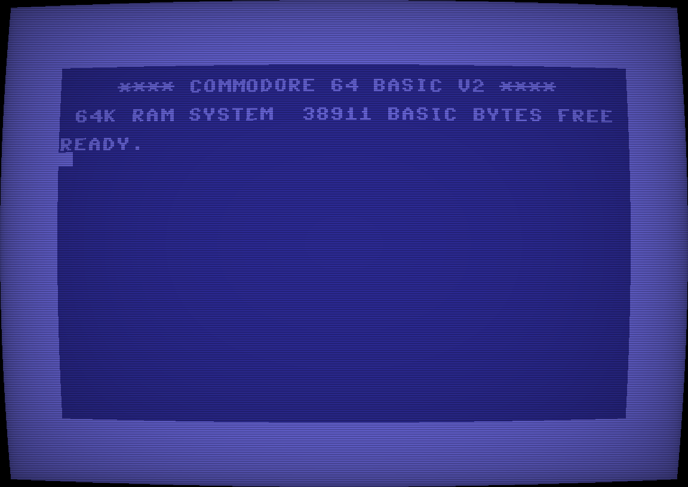

# C64 Console

A Windows console with the look and feel of the Commodore 64: light-blue border, blue screen, a chunky 8×8 font and the blinking `READY.` cursor.


See [PLAN.md](PLAN.md) for the full roadmap.

## Status

| Milestone | State | Git tag |
|-----------|-------|---------|
| 1. Skeleton: C64 window, boot screen, blinking cursor | ✅ done | `MILESTONE_1` |
| 2. Shell hosting: cmd.exe runs inside the window through ConPTY | ✅ done | `MILESTONE_2` |
| 3. VT completeness: scroll regions, alternate screen, resize, scrollback, copy/paste | ✅ done | `MILESTONE_3` |
| 4. Look & feel: layouts, fullscreen, CRT effect, colour keys, `READY.` prompt | ✅ done | `MILESTONE_4` |
| 5. Sound & extras: key clicks, startup chirp, settings, choice of shell | next | |

The window runs a real **cmd.exe**. It prints the C64 banner, and cmd's prompt is the C64's `READY.` with the cursor on the line below. Typing, Enter, Backspace, the arrow keys, Home/End, Delete, Tab completion, Ctrl+C and the F-keys are all passed to the shell. Typing `exit` closes the window.

Full-screen programs work too: the alternate screen, scroll regions and application cursor keys are supported, so `vim`, `less` and `htop` in WSL draw correctly. Colours from programs, including 256-colour and 24-bit colours, are mapped to the nearest of the 16 C64 colours, for both text and background.

### Layouts and the CRT effect

- **Modern** (the default): the grid starts at 80×25 and grows or shrinks to fill the window. Ctrl+Plus / Ctrl+Minus changes the pixel size.
- **Authentic**: always 40×25, like the real machine. Making the window bigger makes the pixels bigger.
- **CRT effect**: a curved picture with scanlines and darker edges, like an old TV. It is drawn on the CPU, at whole-number scales only, so pixels stay crisp.



### Command-line options

```powershell
C64Console.exe --layout authentic --crt
```

| Option | What it does |
|--------|--------------|
| `--layout modern` / `--layout authentic` | Resizable grid (default) or a fixed 40×25 screen |
| `--columns N`, `--rows N` | Starting grid size in the modern layout (default 80×25) |
| `--crt` | Start with the CRT effect on |
| `--prompt classic` | Keep cmd's usual `C:\Users\you>` prompt instead of `READY.` |

### Keys and mouse

| Action | How |
|--------|-----|
| Fullscreen | Alt+Enter |
| Switch layout (modern / authentic) | Ctrl+Shift+L |
| CRT effect on / off | Ctrl+Shift+R |
| Text colour, like the C64's CTRL + 1–8 | Ctrl+F1 … Ctrl+F8: black, white, red, cyan, purple, green, blue, yellow |
| Text colour, like the C64's C= + 1–8 | Ctrl+Shift+F1 … F8: orange, brown, light red, dark grey, grey, light green, light blue, light grey |
| Scroll back through output | Mouse wheel, or Shift+PageUp / Shift+PageDown. Typing jumps back to the live screen |
| Select text | Drag with the left mouse button |
| Copy | Ctrl+C or Ctrl+Shift+C while text is selected (Ctrl+C without a selection is sent to the shell), or right-click |
| Paste | Ctrl+V, Ctrl+Shift+V, Shift+Insert, or right-click with nothing selected |
| Bigger / smaller pixels (modern layout) | Ctrl+Plus / Ctrl+Minus |

As on the C64, a new text colour applies to what is typed and printed from then on; text already on screen keeps its colour. You can even pick blue on blue.

### `READY.` in other shells and terminals

[`extras/prompts`](extras/prompts) has the same prompt for use elsewhere: `ready.cmd` for cmd (also from AutoRun) and `ready.ps1` for PowerShell (dot-source it or add it to `$PROFILE`).

Requires Windows 10 version 1809 or later, which is when ConPTY was added.

## Run it

**Download:** every push builds `C64Console.exe` on GitHub Actions. Open the latest run of the **build** workflow and download the `C64Console-win-x64` artifact. It is self-contained, so you don't need to install .NET.

**Build from source** (Windows, .NET 8 SDK):

```powershell
dotnet run --project src/C64Console.App
```

Run the tests (any OS):

```sh
dotnet test tests/C64Console.Core.Tests
```

Render the boot screen to a PNG (any OS). The arguments are the output file, the scale, the column count, and optionally `--crt`:

```sh
dotnet run --project tools/C64Console.Preview -- docs/boot-screen.png 2 40
```

```sh
dotnet run --project tools/C64Console.Preview -- docs/crt-screen.png 3 40 --crt
```

## Project layout

| Path | What it is |
|------|------------|
| `src/C64Console.Core` | Platform-independent logic: palette and colour mapping, font, screen buffer (scrollback, alternate screen, resize, selection text), VT parser (`VtTerminal`), key encoding, frame renderer, CRT filter, layouts, colour keys, boot screen and prompt, cursor blink |
| `src/C64Console.Pty` | Runs the shell inside a Windows pseudo console (ConPTY) |
| `src/C64Console.App` | WPF window. It shows the rendered frame, scaled by a whole number for crisp pixels |
| `src/C64Console.Core/Assets/font.txt` | The 8×8 font as editable ASCII art |
| `tests/C64Console.Core.Tests` | xUnit tests for Core |
| `tools/C64Console.Preview` | Renders a screenshot PNG without Windows |
| `extras/prompts` | `READY.` prompt scripts for cmd and PowerShell |

## About the font

The font is an original 8×8 design drawn in the C64 style. It does **not** use Commodore's character ROM. To change a glyph, edit the `#`/`.` art in `font.txt`; the file is embedded in the build and checked by the tests.
