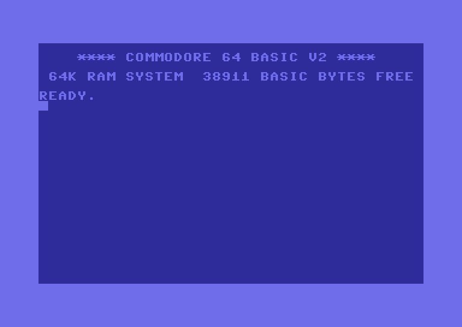

# C64 Console

A Windows console with the look and feel of the Commodore 64: light-blue border, blue screen, a chunky 8×8 font and the blinking `READY.` cursor.



See [PLAN.md](PLAN.md) for the full roadmap.

## Status

| Milestone | State | Git tag |
|-----------|-------|---------|
| 1. Skeleton: C64 window, boot screen, blinking cursor | ✅ done | `MILESTONE_1` |
| 2. Shell hosting: cmd.exe runs inside the window through ConPTY | ✅ done | |
| 3. VT completeness: scroll regions, alternate screen, resize, scrollback, copy/paste | ✅ done | |
| 4. Look & feel: layouts, fullscreen, CRT shader, colour keys, `READY.` prompts | next | |

The window now runs a real **cmd.exe**. It prints the C64 banner and `READY.`, then gives you the normal cmd prompt. Typing, Enter, Backspace, the arrow keys, Home/End, Delete, Tab completion, Ctrl+C and the F-keys are all passed to the shell. Text colours from programs are mapped to the closest C64 colours. Typing `exit` closes the window.

The screen starts 40×25, like the C64. Resize the window and the text grid grows or shrinks to fill it (the shell is told the new size). You can also choose the starting size:

```powershell
C64Console.exe --columns 80 --rows 30
```

Full-screen programs work too: the alternate screen, scroll regions and application cursor keys are supported, so `vim`, `less` and `htop` in WSL draw correctly. Colours from programs, including 256-colour and 24-bit colours, are mapped to the nearest of the 16 C64 colours, for both text and background.

### Keys and mouse

| Action | How |
|--------|-----|
| Scroll back through output | Mouse wheel, or Shift+PageUp / Shift+PageDown. Typing jumps back to the live screen |
| Select text | Drag with the left mouse button |
| Copy | Ctrl+C or Ctrl+Shift+C while text is selected (Ctrl+C without a selection is sent to the shell), or right-click |
| Paste | Ctrl+V, Ctrl+Shift+V, Shift+Insert, or right-click with nothing selected |
| Bigger / smaller pixels | Ctrl+Plus / Ctrl+Minus (the window keeps its size, the grid adapts) |

Requires Windows 10 version 1809 or later, which is when ConPTY was added.

## Run it

**Download:** every push builds `C64Console.exe` on GitHub Actions. Open the latest run of the **build** workflow and download the `C64Console-win-x64` artifact. It is self-contained, so you don't need to install .NET.

**Build from source** (Windows, .NET 8 SDK):

```powershell
dotnet run --project src/C64Console.App
```

Run the tests (any OS):

```sh
dotnet test tests/C64Console.Core.Tests
```

Render the boot screen to a PNG (any OS). The arguments are the output file, the scale, and the column count:

```sh
dotnet run --project tools/C64Console.Preview -- docs/boot-screen.png 2 40
```

## Project layout

| Path | What it is |
|------|------------|
| `src/C64Console.Core` | Platform-independent logic: palette and colour mapping, font, screen buffer (scrollback, alternate screen, resize, selection text), VT parser (`VtTerminal`), key encoding, frame renderer, boot screen, cursor blink |
| `src/C64Console.Pty` | Runs the shell inside a Windows pseudo console (ConPTY) |
| `src/C64Console.App` | WPF window. It shows the rendered frame, scaled by a whole number for crisp pixels |
| `src/C64Console.Core/Assets/font.txt` | The 8×8 font as editable ASCII art |
| `tests/C64Console.Core.Tests` | xUnit tests for Core |
| `tools/C64Console.Preview` | Renders a screenshot PNG without Windows |

## About the font

The font is an original 8×8 design drawn in the C64 style. It does **not** use Commodore's character ROM. To change a glyph, edit the `#`/`.` art in `font.txt`; the file is embedded in the build and checked by the tests.
